# Admin Flow & Back-Office Operations

## 1. Administrative Architecture & Navigation Flow

```mermaid
graph TD
    Admin[Admin Console: /admin] --> MenuMgr[Menu & Modifiers Manager]
    Admin --> FloorMgr[Rooms & Tables Layout]
    Admin --> QRMgr[Dynamic QR Code Generator]
    Admin --> InvMgr[Inventory & Recipe BOM]
    Admin --> UserMgr[Staff & Role RBAC]
    Admin --> ReportMgr[Sales & Financial Analytics]
    Admin --> PrintMgr[Thermal Printer Health & Print Jobs]
    Admin --> SettingMgr[Tax, Hotel Info, Currency & Feature Toggles]

    MenuMgr --> CatCrud[Categories & Subcategories]
    MenuMgr --> ItemCrud[Item Pricing, Tax %, Dietary Flags]
    MenuMgr --> ModGroup[Modifier Groups: Add-ons & Radio options]

    FloorMgr --> RoomList[Rooms: Floors, Occupancy]
    FloorMgr --> TableList[Tables: Sections, Seating Capacity]

    QRMgr --> QRBulk[Bulk QR Export & PDF Print Sheets]
    QRMgr --> QRRotate[QR Token Regeneration / Invalidation]

    InvMgr --> StockAudit[Real-time Stock Levels & Low Stock Alerts]
    InvMgr --> RecipeBOM[Recipe Bill of Materials: auto-deduct]
    InvMgr --> RestockLog[Stock Inwarding / Wastage Logs]

    PrintMgr --> PrinterFleet[Thermal Printers Online/Offline Status]
    PrintMgr --> FailedQueue[Failed Print Queue: Retry & Audit Logs]
```

---

## 2. Dynamic QR Management & Lifecycle
1. Admin creates or edits a Room (e.g., `Room 204`) or Table (e.g., `Table 14`).
2. The system generates a cryptographic QR token (`token: "tbl-a7f92b..."`).
3. Admin prints table tent cards or room service leaflets.
4. If a QR token is compromised or table layout rearranged, Admin can rotate the token with a single click, instantly invalidating previous scans without losing order histories.
