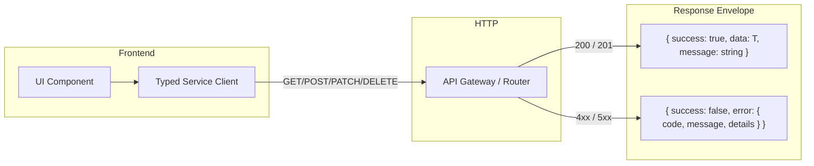

# REST API Contract Specification

## 1. Architectural Principles
- **Transport**: HTTPS with standard JSON payloads (`application/json`).
- **Standard Envelope**: All endpoints return a structured envelope guaranteeing consistent consumption on the client.
- **Idempotency**: All mutation requests (such as `POST /orders`, `POST /bills/{id}/payments`) support optional `Idempotency-Key` headers to protect against network re-transmissions.
- **No Hardcoded Endpoints**: Client calls use `src/services/api/` wrappers backed by `NEXT_PUBLIC_API_URL`.



---

## 2. Standard Envelopes

### Success Envelope
```typescript
interface ApiResponse<T> {
  success: true;
  data: T;
  message?: string;
}
```

### Paginated Envelope
```typescript
interface PaginatedResult<T> {
  data: T[];
  total: number;
  page: number;
  limit: number;
  totalPages: number;
}
```

### Error Envelope
```typescript
interface ApiErrorResponse {
  success: false;
  error: {
    code: string;       // e.g., "ITEM_OUT_OF_STOCK", "INVALID_QR_TOKEN"
    message: string;    // Human-readable message
    details?: Record<string, unknown>;
  };
}
```

---

## 3. Endpoints Matrix

### Menu & Context
- `GET /menu/context/{qrToken}`: Resolves QR context (Room or Table) and checks active session.
- `GET /menu/categories`: Returns active menu categories.
- `GET /menu/items?categoryId={id}&search={q}`: Returns menu items with modifier groups.
- `GET /menu/items/{id}`: Returns individual item detail.
- `POST /menu/items`: Admin creates new menu item.
- `PATCH /menu/items/{id}`: Admin updates item or toggles availability.

### Orders
- `POST /orders/validate`: Pre-checkout validation of item availability and real server pricing.
- `POST /orders`: Creates an order (accepts `CreateOrderPayload`).
- `GET /orders/{id}`: Fetches complete order details, item breakdown, and timeline.
- `GET /orders?status={s}&qrType={type}&page={p}&limit={l}`: Staff POS order list.
- `PATCH /orders/{id}/status`: Staff updates order status.
- `POST /orders/{id}/cancel`: Submits cancellation request with mandatory reason.

### Kitchen (KDS)
- `GET /kitchen/kots`: Returns all active kitchen order tickets.
- `PATCH /kitchen/kots/{id}/status`: Transitions KOT status (`ACCEPTED`, `PREPARING`, `READY`, `SERVED`).

### Billing & Payments
- `GET /bills/{id}`: Fetches itemized bill including taxes and discount history.
- `GET /bills/order/{orderId}`: Retrieves or creates bill for order.
- `POST /bills/{id}/payments`: Records payment (`CASH`, `CARD`, `UPI`, `ROOM_CHARGE`).
- `POST /bills/{id}/discount`: Applies authorized manager discount.
- `POST /bills/{id}/void`: Voids bill with audit trail.

### Printers
- `GET /printers`: Fleet status of thermal receipt and KOT printers.
- `GET /print-jobs?status={s}`: Print queue job listing.
- `POST /print-jobs/{id}/retry`: Retries failed print job.
- `POST /print-jobs/{id}/reprint`: Re-dispatches duplicate print job.

### Rooms & Tables
- `GET /rooms`: List all rooms with current status.
- `GET /tables`: List all restaurant tables with live status.
