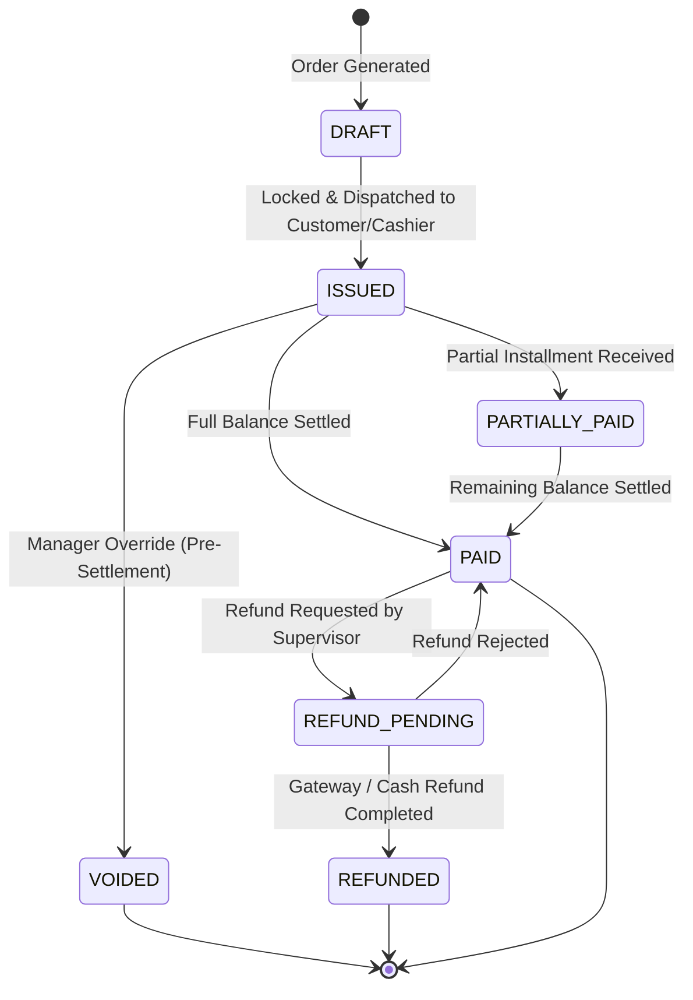

# SCULPX E-Billing — Billing & Payment Contract Specification

> **Target Audience**: Financial Integration Engineer, Backend API Developer, Cashier Supervisors  
> **Topic**: Authoritative Server Calculations, Fiscal Tax Rules, Payment Gateways, Refunds  

---

## 1. Authoritative Backend Principles

1. **Frontend Is NOT the Authority**:
   - The frontend calculates estimates for immediate responsive UI feedback, but the backend is the SOLE authority for item prices, modifiers, discounts, GST tax brackets, service charges, and final grand totals.
2. **Immutable Price Snapshots**:
   - A bill MUST copy the exact item names, modifier rates, and tax percentages into `bill_items` at the moment of bill generation. Subsequent menu price changes or tax adjustments must NEVER alter historical bills.
3. **Zero Frontend Card Storage**:
   - Card numbers, CVVs, and sensitive payment tokens are NEVER held or persisted in frontend state or localStorage. Online card transactions use PCI-DSS tokenized SDKs (Razorpay/Stripe).
4. **Duplicate Charge Protection**:
   - All payment submissions MUST include an `Idempotency-Key` HTTP header. Repeated submissions with the same key return the existing payment result without double-charging.

---

## 2. Bill Lifecycle & State Machine

### 2.1 State Definitions

| Bill State | Description | Balance Condition | Permitted Operations |
|---|---|---|---|
| `DRAFT` | Editable draft tally while table is actively ordering | `due_amount == subtotal + taxes` | Add items, remove items, recalculate. |
| `ISSUED` | Final GST tax invoice generated; prices locked | `due_amount == grand_total` | Apply manager discount, accept payment, print receipt. |
| `PARTIALLY_PAID` | Split bill or partial payment received | `0 < due_amount < grand_total` | Accept remaining installment, view payment log. |
| `PAID` | Fully settled; zero outstanding balance | `due_amount == 0` | Print receipt, issue duplicate copy, request refund. |
| `VOIDED` | Invalidate bill due to error, comp, or walkout | N/A (Void) | View audit trail only. |
| `REFUND_PENDING`| Refund workflow initiated, awaiting supervisor sign-off | N/A | Review reason, approve/reject refund. |
| `REFUNDED` | Money returned to guest; transaction reversed | `due_amount == 0` (Marked Refunded) | Print credit note / refund receipt. |

---

## 3. Financial Calculation Standards (Indian GST Model)

### 3.1 Step-by-Step Calculation Engine

$$\text{Subtotal} = \sum (\text{Item Base Price} + \sum \text{Modifier Prices}) \times \text{Quantity}$$

$$\text{Discounted Subtotal} = \max(0, \text{Subtotal} - \text{Discount Amount})$$

$$\text{CGST} = \text{Discounted Subtotal} \times 0.025 \quad (2.5\%)$$

$$\text{SGST} = \text{Discounted Subtotal} \times 0.025 \quad (2.5\%)$$

$$\text{Service Charge} = \text{Discounted Subtotal} \times 0.05 \quad (5.0\% \text{ discretionary})$$

$$\text{Pre-Rounding Total} = \text{Discounted Subtotal} + \text{CGST} + \text{SGST} + \text{Service Charge}$$

$$\text{Grand Total} = \text{round}(\text{Pre-Rounding Total}, 2)$$

$$\text{Due Amount} = \max(0, \text{Grand Total} - \text{Paid Amount})$$

### 3.2 Rounding Rules
- All currency values stored in database with `NUMERIC(10, 2)` precision (paise).
- Standard half-up rounding applied at the final grand total level.

---

## 4. Payment Methods & Verification

### 4.1 Payment Types

| Method Code | Description | Processing Flow | Verification Requirement |
|---|---|---|---|
| `UPI` | Unified Payments Interface (Dynamic QR / Intent) | Guest scans dynamic UPI QR with embedded amount & invoice reference. | Webhook from payment gateway or cashier manual UTR entry. |
| `CARD` | Credit / Debit Card via EDC Thermal Terminal | Cashier inserts/taps card on EDC machine; enters approval code. | Card last 4 digits + EDC terminal batch/approval code. |
| `CASH` | Cash at billing counter | Cashier enters tendered cash amount; system calculates change. | Cashier shift drawer reconciliation. |
| `ROOM_CHARGE`| Post to Hotel Guest Room Folio | Guest in room dining billed to master PMS room folio account. | Guest room number + folio ID verification. |
| `NET_BANKING`| Corporate transfer / direct bank remittance | Banquets / corporate accounts. | Bank reference code. |

### 4.2 Webhook & Gateway Settlement
For online customer self-checkout payments (Razorpay / Stripe):
1. Client receives server order ID from `POST /orders`.
2. Frontend opens payment checkout modal.
3. On payment completion, gateway sends signed webhook to backend (`POST /api/v1/payments/webhooks/razorpay`).
4. Backend verifies cryptographic HMAC signature using gateway secret.
5. Backend updates `payments` status to `SUCCESS` and `bills` status to `PAID`.
6. Real-time WebSocket dispatches `PAYMENT_RECORDED` to client.
