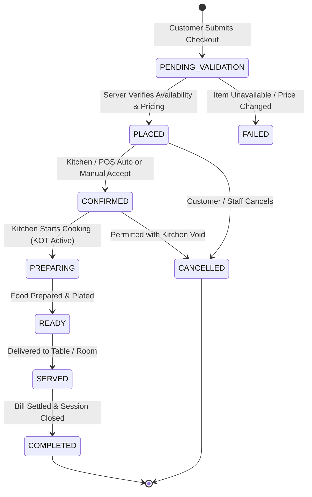
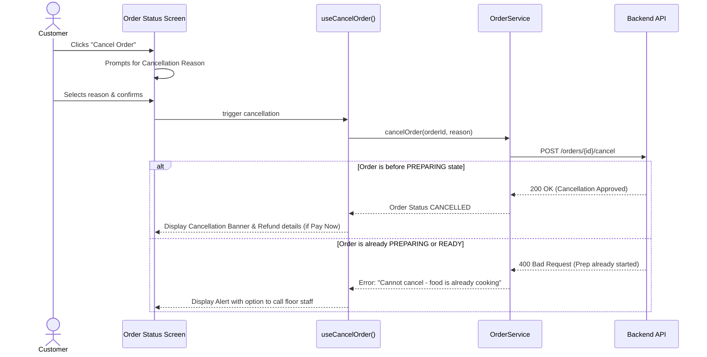

# Customer Flow (QR Dine-In & Room Service)

## 1. End-to-End Customer Flow Diagram

```mermaid
flowchart TD
    Scan([Guest Scans QR Code]) --> Resolve[Resolve Context: /menu/[qrToken]]
    Resolve --> Menu[Browse Menu & Categories]
    Menu --> ItemModal[Open Item & Choose Modifiers]
    ItemModal --> Cart[Add to Cart & Review]
    Cart --> Checkout[Checkout Form & Preferences]
    Checkout --> PaymentChoice{Payment Choice}

    PaymentChoice -->|Pay Now| PayOnline[Digital Payment: UPI / Card / Gateway]
    PaymentChoice -->|Pay Later| PayLaterDecision{Context Type}

    PayLaterDecision -->|ROOM| RoomCharge[Post to Room Folio]
    PayLaterDecision -->|TABLE| CashCounter[Pay at Table / Cash Counter]

    PayOnline --> ValidateServer[Backend Order Validation]
    RoomCharge --> ValidateServer
    CashCounter --> ValidateServer

    ValidateServer --> OrderCreated[Order Confirmed: /order/[orderId]]
    OrderCreated --> LiveStatus[Live Status Timeline via WebSockets]
    LiveStatus --> Delivered[Items Served / Delivered]
    Delivered --> ViewBill[Access Itemized E-Bill: /bill/[billId]]
```

---

## 2. Order Lifecycle State Machine



---

## 3. Order Cancellation Flow


