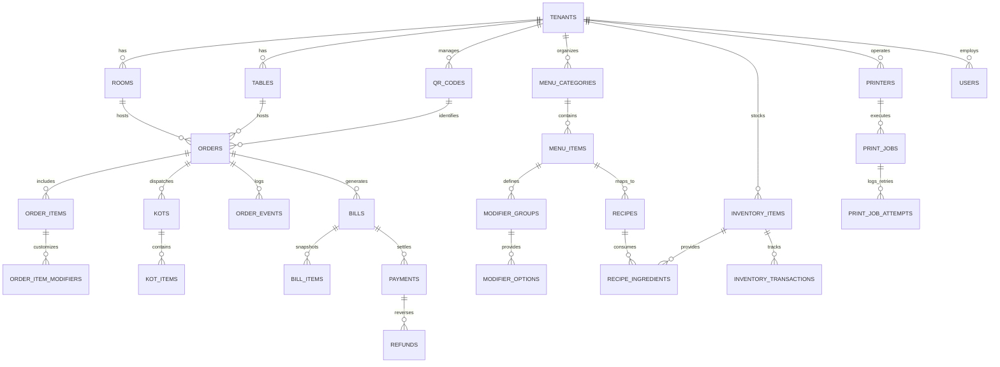

# SCULPX E-Billing — Data Models & PostgreSQL Handover Specification

> **Target Database**: PostgreSQL 15+  
> **Audience**: Backend Database Architect, Node.js Engineers  
> **Status**: Conceptual Entity Relationship & Production DDL Recommendations  

---

## 1. Core Architectural Distinctions

The database design must respect the strict operational boundaries of hospitality:

1. **Order is NOT a Bill**:
   - An `Order` tracks requested culinary items, preparation stages, and kitchen dispatch.
   - A `Bill` is an immutable financial tax document capturing snapshot item prices, tax computations (CGST/SGST), and payment balances.
2. **Bill is NOT a Payment**:
   - A `Bill` represents money owed. A `Payment` records an actual financial settlement transaction against that bill. A single bill may have multiple payments (split bill, card + cash).
3. **KOT is NOT an Order**:
   - A single customer `Order` can produce multiple `KOT` (Kitchen Order Tickets) as guests order drinks first, then mains, or add desserts later.
4. **Inventory Transaction is NOT a stock field update**:
   - Direct stock field mutations lose auditability. Every stock change MUST create an immutable `inventory_transactions` row with delta, reason, and actor.
5. **Print Job is NOT a physical print**:
   - A print job in `print_jobs` represents a queued print instruction. Physical output is confirmed via printer status callbacks.

---

## 2. Mermaid Entity Relationship Diagram



---

## 3. Recommended PostgreSQL Table Definitions (DDL)

### 3.1 Identity & Staff Access

```sql
-- Staff Users
CREATE TABLE users (
    id UUID PRIMARY KEY DEFAULT gen_random_uuid(),
    tenant_id UUID NOT NULL,
    email VARCHAR(255) NOT NULL UNIQUE,
    name VARCHAR(255) NOT NULL,
    role VARCHAR(50) NOT NULL CHECK (role IN ('SUPER_ADMIN', 'ADMIN', 'MANAGER', 'CAPTAIN', 'WAITER', 'CASHIER', 'KITCHEN_STAFF')),
    phone_number VARCHAR(30),
    is_active BOOLEAN NOT NULL DEFAULT TRUE,
    password_hash VARCHAR(255) NOT NULL,
    created_at TIMESTAMPTZ NOT NULL DEFAULT NOW(),
    updated_at TIMESTAMPTZ NOT NULL DEFAULT NOW()
);

-- Permissions & Grants
CREATE TABLE user_permissions (
    id UUID PRIMARY KEY DEFAULT gen_random_uuid(),
    user_id UUID NOT NULL REFERENCES users(id) ON DELETE CASCADE,
    permission_key VARCHAR(100) NOT NULL,
    granted_at TIMESTAMPTZ NOT NULL DEFAULT NOW(),
    UNIQUE(user_id, permission_key)
);
```

### 3.2 Floor Operations & QR Fleet

```sql
-- Restaurant Tables
CREATE TABLE tables (
    id UUID PRIMARY KEY DEFAULT gen_random_uuid(),
    tenant_id UUID NOT NULL,
    table_number VARCHAR(50) NOT NULL,
    display_name VARCHAR(100) NOT NULL,
    capacity INT NOT NULL DEFAULT 4,
    status VARCHAR(50) NOT NULL DEFAULT 'VACANT' CHECK (status IN ('VACANT', 'OCCUPIED', 'RESERVED', 'BILL_REQUESTED', 'DIRTY')),
    section VARCHAR(100) DEFAULT 'Main Dining',
    current_order_id UUID,
    created_at TIMESTAMPTZ NOT NULL DEFAULT NOW(),
    updated_at TIMESTAMPTZ NOT NULL DEFAULT NOW()
);

-- Guest Rooms & Suites
CREATE TABLE rooms (
    id UUID PRIMARY KEY DEFAULT gen_random_uuid(),
    tenant_id UUID NOT NULL,
    room_number VARCHAR(50) NOT NULL,
    floor VARCHAR(50) NOT NULL,
    status VARCHAR(50) NOT NULL DEFAULT 'VACANT' CHECK (status IN ('VACANT', 'OCCUPIED', 'DO_NOT_DISTURB', 'CLEANING')),
    guest_name VARCHAR(255),
    folio_id VARCHAR(100),
    created_at TIMESTAMPTZ NOT NULL DEFAULT NOW(),
    updated_at TIMESTAMPTZ NOT NULL DEFAULT NOW()
);

-- QR Tokens
CREATE TABLE qr_codes (
    id UUID PRIMARY KEY DEFAULT gen_random_uuid(),
    tenant_id UUID NOT NULL,
    token VARCHAR(100) NOT NULL UNIQUE,
    type VARCHAR(20) NOT NULL CHECK (type IN ('TABLE', 'ROOM')),
    table_id UUID REFERENCES tables(id) ON DELETE SET NULL,
    room_id UUID REFERENCES rooms(id) ON DELETE SET NULL,
    is_active BOOLEAN NOT NULL DEFAULT TRUE,
    last_scanned_at TIMESTAMPTZ,
    created_at TIMESTAMPTZ NOT NULL DEFAULT NOW()
);
```

### 3.3 Menu Catalog & Modifiers

```sql
-- Categories
CREATE TABLE menu_categories (
    id UUID PRIMARY KEY DEFAULT gen_random_uuid(),
    tenant_id UUID NOT NULL,
    name VARCHAR(255) NOT NULL,
    description TEXT,
    display_order INT NOT NULL DEFAULT 0,
    is_active BOOLEAN NOT NULL DEFAULT TRUE,
    created_at TIMESTAMPTZ NOT NULL DEFAULT NOW()
);

-- Menu Items
CREATE TABLE menu_items (
    id UUID PRIMARY KEY DEFAULT gen_random_uuid(),
    category_id UUID NOT NULL REFERENCES menu_categories(id) ON DELETE RESTRICT,
    name VARCHAR(255) NOT NULL,
    description TEXT,
    price NUMERIC(10, 2) NOT NULL CHECK (price >= 0),
    is_available BOOLEAN NOT NULL DEFAULT TRUE,
    dietary VARCHAR(50) CHECK (dietary IN ('VEG', 'NON_VEG', 'VEGAN', 'CONTAINS_EGG')),
    spice_level VARCHAR(50) CHECK (spice_level IN ('NONE', 'MILD', 'MEDIUM', 'HOT', 'EXTRA_HOT')),
    preparation_time_minutes INT DEFAULT 15,
    tax_rate_percentage NUMERIC(5, 2) NOT NULL DEFAULT 5.00,
    created_at TIMESTAMPTZ NOT NULL DEFAULT NOW(),
    updated_at TIMESTAMPTZ NOT NULL DEFAULT NOW()
);

-- Modifier Groups
CREATE TABLE modifier_groups (
    id UUID PRIMARY KEY DEFAULT gen_random_uuid(),
    menu_item_id UUID NOT NULL REFERENCES menu_items(id) ON DELETE CASCADE,
    name VARCHAR(255) NOT NULL,
    is_required BOOLEAN NOT NULL DEFAULT FALSE,
    min_selections INT NOT NULL DEFAULT 0,
    max_selections INT NOT NULL DEFAULT 1
);

-- Modifier Options
CREATE TABLE modifier_options (
    id UUID PRIMARY KEY DEFAULT gen_random_uuid(),
    group_id UUID NOT NULL REFERENCES modifier_groups(id) ON DELETE CASCADE,
    name VARCHAR(255) NOT NULL,
    price NUMERIC(10, 2) NOT NULL DEFAULT 0.00 CHECK (price >= 0)
);
```

### 3.4 Orders, KOTs & Kitchen Progression

```sql
-- Orders
CREATE TABLE orders (
    id UUID PRIMARY KEY DEFAULT gen_random_uuid(),
    tenant_id UUID NOT NULL,
    order_number VARCHAR(50) NOT NULL UNIQUE,
    source VARCHAR(50) NOT NULL CHECK (source IN ('CUSTOMER_QR', 'STAFF_POS')),
    qr_code_id UUID REFERENCES qr_codes(id),
    table_id UUID REFERENCES tables(id),
    room_id UUID REFERENCES rooms(id),
    customer_name VARCHAR(255),
    customer_phone VARCHAR(30),
    status VARCHAR(50) NOT NULL DEFAULT 'CONFIRMED' CHECK (status IN ('PENDING_VALIDATION', 'PLACED', 'CONFIRMED', 'PREPARING', 'READY', 'SERVED', 'COMPLETED', 'CANCELLED')),
    payment_preference VARCHAR(50) NOT NULL CHECK (payment_preference IN ('PAY_NOW', 'PAY_LATER')),
    subtotal NUMERIC(10, 2) NOT NULL,
    tax_total NUMERIC(10, 2) NOT NULL,
    service_charge NUMERIC(10, 2) NOT NULL DEFAULT 0.00,
    grand_total NUMERIC(10, 2) NOT NULL,
    cancellation_reason TEXT,
    created_at TIMESTAMPTZ NOT NULL DEFAULT NOW(),
    updated_at TIMESTAMPTZ NOT NULL DEFAULT NOW()
);

-- Order Items
CREATE TABLE order_items (
    id UUID PRIMARY KEY DEFAULT gen_random_uuid(),
    order_id UUID NOT NULL REFERENCES orders(id) ON DELETE CASCADE,
    menu_item_id UUID NOT NULL REFERENCES menu_items(id),
    item_name VARCHAR(255) NOT NULL,
    quantity INT NOT NULL CHECK (quantity > 0),
    unit_price NUMERIC(10, 2) NOT NULL,
    total_price NUMERIC(10, 2) NOT NULL,
    tax_amount NUMERIC(10, 2) NOT NULL,
    special_instructions TEXT,
    status VARCHAR(50) NOT NULL DEFAULT 'PLACED' CHECK (status IN ('PLACED', 'PREPARING', 'READY', 'SERVED', 'CANCELLED'))
);

-- Kitchen Order Tickets (KOT)
CREATE TABLE kots (
    id UUID PRIMARY KEY DEFAULT gen_random_uuid(),
    order_id UUID NOT NULL REFERENCES orders(id) ON DELETE CASCADE,
    kot_number VARCHAR(50) NOT NULL UNIQUE,
    status VARCHAR(50) NOT NULL DEFAULT 'NEW' CHECK (status IN ('NEW', 'ACCEPTED', 'PREPARING', 'READY', 'SERVED', 'CANCELLED')),
    station VARCHAR(100) DEFAULT 'Main Kitchen',
    accepted_at TIMESTAMPTZ,
    ready_at TIMESTAMPTZ,
    served_at TIMESTAMPTZ,
    created_at TIMESTAMPTZ NOT NULL DEFAULT NOW()
);

-- KOT Items
CREATE TABLE kot_items (
    id UUID PRIMARY KEY DEFAULT gen_random_uuid(),
    kot_id UUID NOT NULL REFERENCES kots(id) ON DELETE CASCADE,
    order_item_id UUID NOT NULL REFERENCES order_items(id),
    quantity INT NOT NULL,
    modifiers_summary TEXT,
    special_instructions TEXT
);
```

### 3.5 Billing, Payments & Fiscal Ledger

```sql
-- Formal Bills
CREATE TABLE bills (
    id UUID PRIMARY KEY DEFAULT gen_random_uuid(),
    tenant_id UUID NOT NULL,
    order_id UUID NOT NULL UNIQUE REFERENCES orders(id),
    bill_number VARCHAR(100) NOT NULL UNIQUE,
    status VARCHAR(50) NOT NULL DEFAULT 'ISSUED' CHECK (status IN ('DRAFT', 'ISSUED', 'PARTIALLY_PAID', 'PAID', 'VOIDED', 'REFUNDED')),
    subtotal NUMERIC(10, 2) NOT NULL,
    discount_amount NUMERIC(10, 2) NOT NULL DEFAULT 0.00,
    discount_reason VARCHAR(255),
    cgst NUMERIC(10, 2) NOT NULL DEFAULT 0.00,
    sgst NUMERIC(10, 2) NOT NULL DEFAULT 0.00,
    service_charge NUMERIC(10, 2) NOT NULL DEFAULT 0.00,
    grand_total NUMERIC(10, 2) NOT NULL,
    paid_amount NUMERIC(10, 2) NOT NULL DEFAULT 0.00,
    due_amount NUMERIC(10, 2) NOT NULL,
    gstin VARCHAR(50) DEFAULT '27AABCT3518Q1Z5',
    issued_at TIMESTAMPTZ NOT NULL DEFAULT NOW(),
    settled_at TIMESTAMPTZ
);

-- Immutable Bill Snapshot Items
CREATE TABLE bill_items (
    id UUID PRIMARY KEY DEFAULT gen_random_uuid(),
    bill_id UUID NOT NULL REFERENCES bills(id) ON DELETE CASCADE,
    name VARCHAR(255) NOT NULL,
    quantity INT NOT NULL,
    unit_price NUMERIC(10, 2) NOT NULL,
    modifiers_price NUMERIC(10, 2) NOT NULL DEFAULT 0.00,
    total_price NUMERIC(10, 2) NOT NULL,
    tax_rate NUMERIC(5, 2) NOT NULL
);

-- Payments
CREATE TABLE payments (
    id UUID PRIMARY KEY DEFAULT gen_random_uuid(),
    bill_id UUID NOT NULL REFERENCES bills(id),
    amount NUMERIC(10, 2) NOT NULL CHECK (amount > 0),
    method VARCHAR(50) NOT NULL CHECK (method IN ('CASH', 'CARD', 'UPI', 'ROOM_CHARGE', 'NET_BANKING')),
    status VARCHAR(50) NOT NULL DEFAULT 'SUCCESS' CHECK (status IN ('PENDING', 'SUCCESS', 'FAILED', 'REFUNDED')),
    transaction_reference VARCHAR(255),
    card_last_four VARCHAR(4),
    upi_id VARCHAR(100),
    room_folio_id VARCHAR(100),
    processed_by UUID REFERENCES users(id),
    notes TEXT,
    created_at TIMESTAMPTZ NOT NULL DEFAULT NOW()
);

-- Refunds
CREATE TABLE refunds (
    id UUID PRIMARY KEY DEFAULT gen_random_uuid(),
    payment_id UUID NOT NULL REFERENCES payments(id),
    amount NUMERIC(10, 2) NOT NULL CHECK (amount > 0),
    reason TEXT NOT NULL,
    status VARCHAR(50) NOT NULL DEFAULT 'PROCESSED' CHECK (status IN ('REQUESTED', 'PROCESSED', 'REJECTED')),
    processed_by UUID NOT NULL REFERENCES users(id),
    created_at TIMESTAMPTZ NOT NULL DEFAULT NOW()
);
```

### 3.6 Inventory, Recipes & Audit

```sql
-- Inventory Raw Ingredients
CREATE TABLE inventory_items (
    id UUID PRIMARY KEY DEFAULT gen_random_uuid(),
    tenant_id UUID NOT NULL,
    name VARCHAR(255) NOT NULL,
    sku VARCHAR(100) NOT NULL UNIQUE,
    category VARCHAR(100) NOT NULL,
    current_stock NUMERIC(10, 3) NOT NULL CHECK (current_stock >= 0),
    minimum_threshold NUMERIC(10, 3) NOT NULL,
    unit VARCHAR(50) NOT NULL CHECK (unit IN ('KG', 'LITER', 'PORTION', 'GRAMS', 'PIECE', 'BOTTLE')),
    unit_cost NUMERIC(10, 2) NOT NULL DEFAULT 0.00,
    supplier VARCHAR(255),
    updated_at TIMESTAMPTZ NOT NULL DEFAULT NOW()
);

-- Recipes (Bill of Materials)
CREATE TABLE recipes (
    id UUID PRIMARY KEY DEFAULT gen_random_uuid(),
    menu_item_id UUID NOT NULL UNIQUE REFERENCES menu_items(id) ON DELETE CASCADE,
    name VARCHAR(255) NOT NULL,
    created_at TIMESTAMPTZ NOT NULL DEFAULT NOW()
);

-- Recipe Ingredients
CREATE TABLE recipe_ingredients (
    id UUID PRIMARY KEY DEFAULT gen_random_uuid(),
    recipe_id UUID NOT NULL REFERENCES recipes(id) ON DELETE CASCADE,
    inventory_item_id UUID NOT NULL REFERENCES inventory_items(id),
    quantity_required NUMERIC(10, 3) NOT NULL CHECK (quantity_required > 0),
    unit VARCHAR(50) NOT NULL
);

-- Immutable Inventory Transaction Ledger
CREATE TABLE inventory_transactions (
    id UUID PRIMARY KEY DEFAULT gen_random_uuid(),
    inventory_item_id UUID NOT NULL REFERENCES inventory_items(id),
    quantity_change NUMERIC(10, 3) NOT NULL, -- negative for usage/wastage, positive for restock
    type VARCHAR(50) NOT NULL CHECK (type IN ('RESTOCK', 'USAGE', 'WASTAGE', 'ADJUSTMENT', 'RETURN')),
    reason TEXT NOT NULL,
    order_id UUID REFERENCES orders(id),
    created_by UUID REFERENCES users(id),
    created_at TIMESTAMPTZ NOT NULL DEFAULT NOW()
);
```

---

## 4. Performance Indexes

```sql
CREATE INDEX idx_orders_tenant_status ON orders(tenant_id, status);
CREATE INDEX idx_orders_created_at ON orders(created_at DESC);
CREATE INDEX idx_kots_status ON kots(status);
CREATE INDEX idx_bills_order_id ON bills(order_id);
CREATE INDEX idx_bills_status ON bills(status);
CREATE INDEX idx_payments_bill_id ON payments(bill_id);
CREATE INDEX idx_inventory_item_low_stock ON inventory_items(tenant_id) WHERE current_stock <= minimum_threshold;
CREATE INDEX idx_inv_tx_item_date ON inventory_transactions(inventory_item_id, created_at DESC);
CREATE INDEX idx_qr_codes_token ON qr_codes(token);
```
