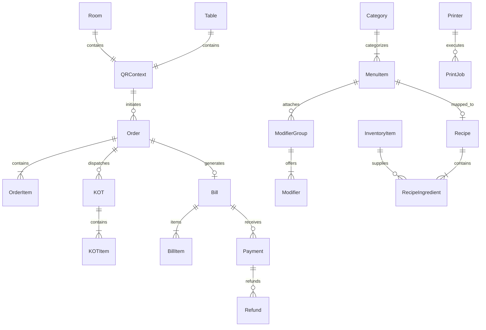

# Data Models & Entity Relationships

## 1. Entity Relationship Diagram (Domain Model)

---

## 2. Core Entities Summary

### `QRContext`
The polymorphic anchor for both in-room dining and dining-room table ordering.
- `token`: Unique identifier encoded in the physical QR code.
- `type`: `"ROOM"` or `"TABLE"`.
- `identifier`: Room number (`"301"`) or table number (`"5"`).
- `displayName`: `"Room 301"` or `"Table 5"`.

### `Order`
Authoritative order record containing immutable snapshots of items, modifier selections, and price points at the exact time of order placement.
- `status`: `PENDING_VALIDATION | PLACED | CONFIRMED | PREPARING | READY | SERVED | COMPLETED | CANCELLED`.
- `paymentPreference`: `PAY_NOW | PAY_LATER`.

### `KOT` (Kitchen Order Ticket)
Routing unit for back-of-house kitchen operations. Multiple KOTs may belong to a single order (e.g., initial order + follow-up round).
- `status`: `NEW | ACCEPTED | PREPARING | READY | SERVED | CANCELLED`.

### `Bill` & `Payment`
E-Billing document containing itemized charges, authorized discounts, applicable taxes (CGST, SGST, service charge), and attached payment logs.
- `payments`: Array of `Payment` records supporting split payments across multiple methods (`CASH`, `CARD`, `UPI`, `ROOM_CHARGE`).
