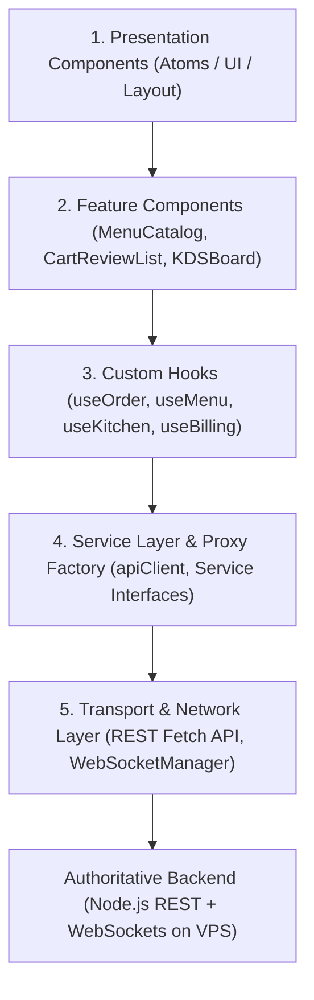

# SCULPX E-Billing — Frontend Architecture & Service Layer

> **Audience**: Frontend Developers, Full-Stack Engineers, System Architects  
> **Topic**: Unidirectional Data Flow, Dual-Track Service Layer, State Architecture  

---

## 1. Architectural Layers & Separation of Concerns

The application strictly follows a 5-layer unidirectional architecture. Presentation components must never directly call `fetch()`, Axios, or raw WebSocket endpoints.



---

## 2. Dual-Track Service Layer (`src/services/api/`)

The application features a standardized dual-track service layer conforming to TypeScript interfaces defined in `src/services/api/interfaces.ts`:

```text
src/services/api/
├── client.ts             # Unified ApiClient with auto-token injection & timeout
├── factory.ts            # Dynamic Service Factory routing between Mock and Live HTTP
├── interfaces.ts         # TypeScript contracts for all 11 domain services
├── http/                 # Concrete HTTP Service implementations calling live REST API
│   ├── auth.http.ts
│   ├── billing.http.ts
│   ├── inventory.http.ts
│   ├── kitchen.http.ts
│   ├── menu.http.ts
│   ├── order.http.ts
│   ├── payment.http.ts
│   ├── printer.http.ts
│   ├── room.http.ts
│   ├── table.http.ts
│   ├── user.http.ts
│   └── index.ts
└── mock/                 # Self-contained Mock Service implementations
    ├── billing.mock.ts
    ├── inventory.mock.ts
    ├── kitchen.mock.ts
    ├── menu.mock.ts
    ├── order.mock.ts
    ├── payment.mock.ts
    ├── printer.mock.ts
    ├── room.mock.ts
    ├── table.mock.ts
    └── user.mock.ts
```

### 2.1 Dynamic Proxy Routing (`factory.ts`)
Hooks import service singletons directly (`import { menuApi, orderApi, ... } from "@/services/api"`). Under the hood, dynamic ES6 Proxies evaluate `ENV.USE_MOCK_API`:
- When `NEXT_PUBLIC_USE_MOCK_API=true`: Calls route to in-memory mock services.
- When `NEXT_PUBLIC_USE_MOCK_API=false`: Calls route directly to `Http*Service` classes communicating over HTTP to the backend on the VPS.

### 2.2 Automatic Bearer Token Injection (`client.ts`)
`ApiClient` inspects outgoing requests: if `token` is not explicitly provided, it automatically extracts the authenticated employee's active JWT from `localStorage` (`restro_staff_auth`) and attaches `Authorization: Bearer <token>`.

---

## 3. State Management Architecture

```text
┌────────────────────────────────────────────────────────┐
│                   Server State (Async)                 │
│                 @tanstack/react-query                  │
│       - Menu Items & Modifiers (staleTime: 3 min)      │
│       - Active Orders (refetchInterval: 15s)           │
│       - Active KOTs (refetchInterval: 10s)             │
│       - Bills & Payments (refetchInterval: 10s)        │
└────────────────────────────────────────────────────────┘
                            ▲
                            │ Invalidations on WS events
┌───────────────────────────┴────────────────────────────┐
│                   Client State (Sync)                  │
│                         Zustand                        │
│       - authStore (Staff Session, JWT, Role)           │
│       - cartStore (Guest Items, Modifiers, Quantities) │
│       - posStore  (Waiter Table-side Draft Order)      │
│       - uiStore   (Toasts, Global Modals)              │
└────────────────────────────────────────────────────────┘
```
