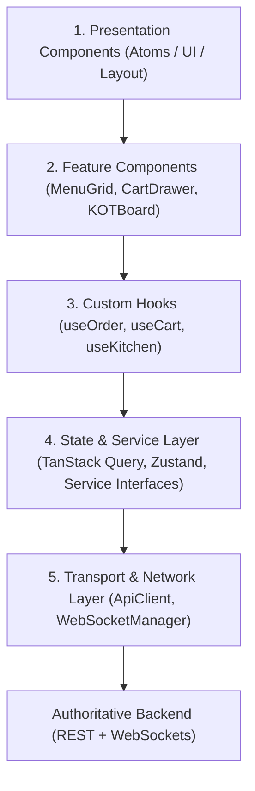
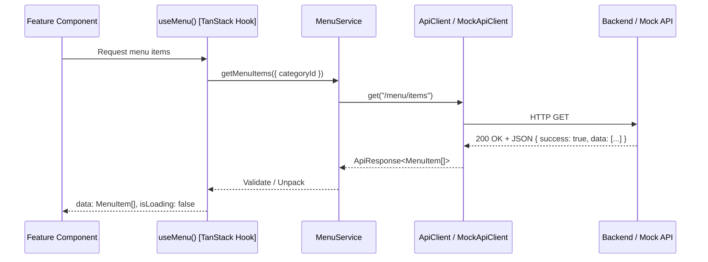
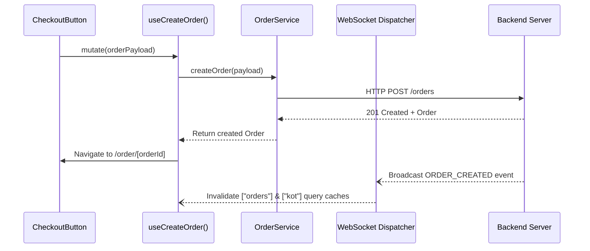

# Frontend Architecture

## 1. Architectural Layers & Separation of Concerns

The application strictly follows a 5-layer unidirectional architecture. Presentation components must never directly call `fetch()`, Axios, or raw WebSocket endpoints.



---

## 2. Directory Responsibilities

```text
src/
├── app/                  # Next.js App Router (pages, layouts, error/loading boundaries)
├── components/           # Reusable generic UI elements
│   ├── ui/               # Design system primitives (Button, Input, Badge, Dialog)
│   ├── layout/           # AppShell, Navbar, Sidebar, MobileFooter
│   └── shared/           # StatusBadges, CurrencyDisplay, EmptyStates
├── features/             # Business domain modules (contain domain components)
│   ├── menu/             # MenuCatalog, ItemCard, ModifierModal
│   ├── cart/             # CartSheet, CartSummary, CartItemRow
│   ├── checkout/         # CheckoutForm, PaymentPreferenceToggle
│   ├── orders/           # OrderTimeline, OrderCard, CancelDialog
│   ├── kitchen/          # KOTCard, KDSBoard, FilterBar
│   ├── billing/          # BillReceipt, DiscountModal, SplitBill
│   ├── payments/         # PaymentSelector, RoomFolioInput
│   ├── rooms/            # RoomGrid, RoomStatusBadge
│   ├── tables/           # FloorPlan, TableCard, TransferTableModal
│   ├── inventory/        # StockTable, RecipeEditor, RestockForm
│   ├── printers/         # PrinterList, PrintJobQueue, ReprintButton
│   ├── users/            # UserList, RoleBadge, UserForm
│   └── reports/          # DailySalesChart, CategoryBreakdown
├── services/             # Concrete data providers matching service interfaces
│   ├── api/              # REST clients (Mock implementations & Live Api implementations)
│   └── websocket/        # Connection manager, event dispatcher, reconnection
├── store/                # Zustand stores (Client-only state: Cart, Session, POS Draft)
├── hooks/                # Reusable React hooks bridging UI with Services & Stores
├── types/                # Canonical TypeScript models and interfaces
├── schemas/              # Zod validation schemas for forms and API payloads
├── constants/            # Routes, status definitions, navigation configs
├── utils/                # Pure formatting, currency, date, and math helpers
├── lib/                  # Shared utilities (cn, query-client)
└── config/               # App configuration & environment parsing
```

---

## 3. Data Flow Pattern

### Query Flow (Read)


### Mutation Flow (Write)

