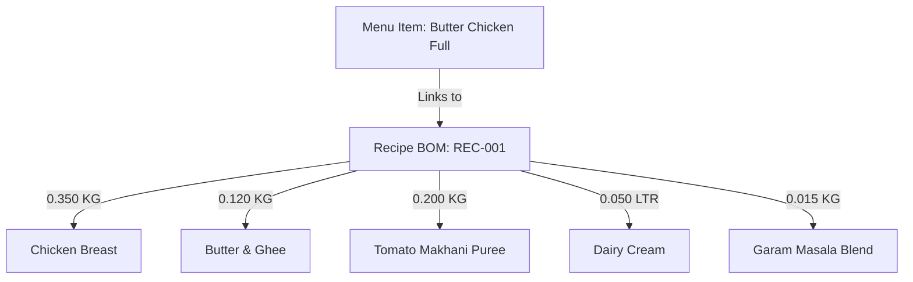

# SCULPX E-Billing — Inventory & Bill-of-Materials Handover Specification

> **Audience**: Backend Database Architect, ERP/Inventory Developer, Kitchen Supervisors  
> **Topic**: Ingredient-Level Tracking, Recipe BOMs, Concurrency Controls, Transaction Ledger  

---

## 1. Core Principles of Food & Beverage Inventory

1. **Frontend Is NOT the Stock Authority**:
   - The frontend never tracks authoritative stock numbers or decides if an item is available.
   - When loading menus, the frontend receives a boolean `isAvailable` flag computed by the backend based on ingredient thresholds.
2. **Concurrent Order Race Conditions**:
   - When two diners at Table 01 and Table 05 simultaneously order the last remaining portion of a dish, the backend MUST use PostgreSQL transactional row locks (`SELECT ... FOR UPDATE` or serializable transactions) to prevent overselling.
3. **Immutable Transaction Journal**:
   - Stock counts are NEVER directly mutated without an accompanying entry in `inventory_transactions`.
   - Every stock addition, deduction, spoilage, or return is an auditable debit/credit event.

---

## 2. Bill of Materials (BOM) & Recipe Mapping



### 2.1 Deducting Multi-Tier Ingredients
When an order item is accepted by the kitchen:
1. Lookup active `recipes` where `menu_item_id = item.id`.
2. For each ingredient in `recipe_ingredients`:
   - Calculate required deduction: $\text{Deduction} = \text{quantity\_required} \times \text{order\_quantity}$.
   - Check if `current_stock >= Deduction`.
   - Insert negative transaction into `inventory_transactions` with `type = 'USAGE'`.
   - Update `inventory_items.current_stock`.

---

## 3. Units of Measurement & Standard Conversions

All raw ingredients in `inventory_items` must use standard metric units:

| Unit Code | Standard Representation | Supported Granularity | Primary Categories |
|---|---|---|---|
| `KG` | Kilograms | 3 decimal places (`0.001 KG = 1 gram`) | Meat, poultry, seafood, produce, dry rice, flour. |
| `LITER` | Liters | 3 decimal places (`0.001 LTR = 1 ml`) | Cooking oils, milk, cream, sauces, syrups. |
| `PORTION` | Standard Portions | 1 decimal place | Pre-portioned frozen patties, marinated cutlets. |
| `PIECE` | Whole Discrete Units | Integer (`1, 2, 3`) | Eggs, whole buns, coconuts, bakery rolls. |
| `BOTTLE` | Discrete Bottled Units | Integer | Imported wine, liquor, carbonated mixers. |

---

## 4. Inventory Transaction Types

```sql
CHECK (type IN ('PURCHASE', 'USAGE', 'ADJUSTMENT', 'WASTAGE', 'RETURN'))
```

1. **`PURCHASE`**:
   - Supplier shipment received at receiving dock.
   - Positive quantity delta. Updates unit purchase cost and weighted average cost.
2. **`USAGE`**:
   - Automated consumption driven by customer order or kitchen preparation.
   - Negative quantity delta. Links to `order_id`.
3. **`ADJUSTMENT`**:
   - Variance reconciliation during physical stocktake audits.
   - Positive or negative delta. Requires mandatory supervisory reason.
4. **`WASTAGE`**:
   - Expired dairy, dropped dishes, burnt food, or prep spoilage.
   - Negative delta. Logged for kitchen cost analysis.
5. **`RETURN`**:
   - Rejected supplier goods returned before acceptance.

---

## 5. Order Cancellation & Stock Restoration Policy

> [!IMPORTANT]
> The backend MUST NOT blindly restore inventory on every order cancellation! The correct policy depends strictly on the lifecycle state of the order:

| Order State When Cancelled | Physical Status of Food | Correct Inventory Policy |
|---|---|---|
| **Before Kitchen Cooking** (`CONFIRMED`, `NEW`) | Raw ingredients have not been touched by chef | **RESTORE STOCK**: Create compensating positive transaction (`type = 'RETURN'`) restoring the reserved ingredient count. |
| **During Cooking / Plating** (`PREPARING`, `READY`) | Food is physically on pan or plated | **DO NOT RESTORE STOCK**: Ingredients were physically destroyed/cooked. Log transaction as `type = 'WASTAGE'` citing cancellation reason. |
| **After Service** (`SERVED`, `COMPLETED`) | Food was eaten or touched by diner | **DO NOT RESTORE STOCK**: Cannot be reused under food hygiene regulations. |
