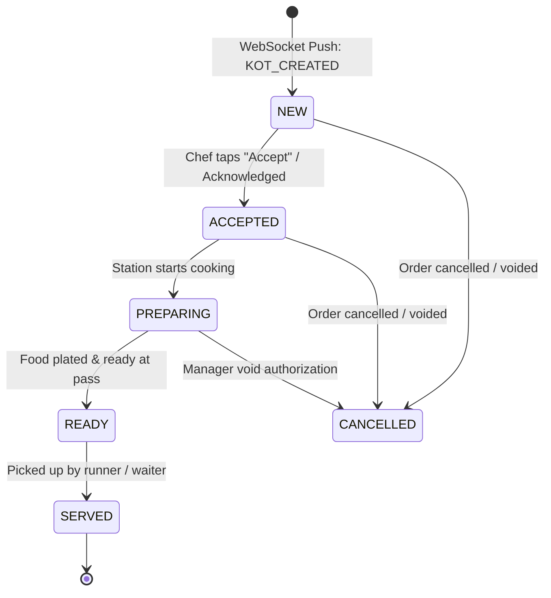
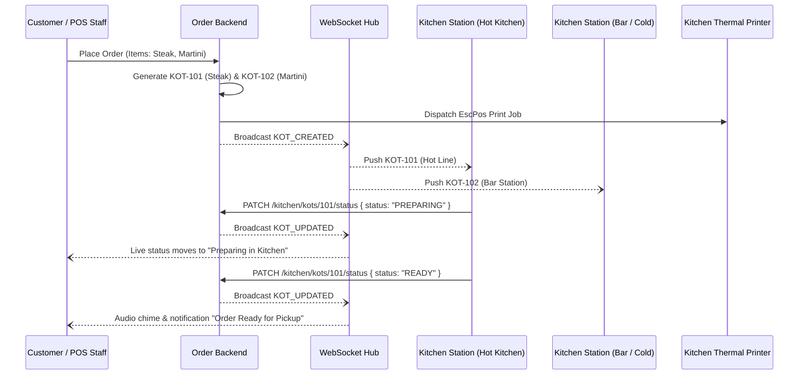

# Kitchen Flow (KOT & KDS)

## 1. Kitchen Display System (KDS) Lifecycle

The Kitchen Display System operates as a high-visibility, touch-optimized station for line cooks and kitchen expediters.

---

## 2. Real-Time Multi-Station Synchronization

