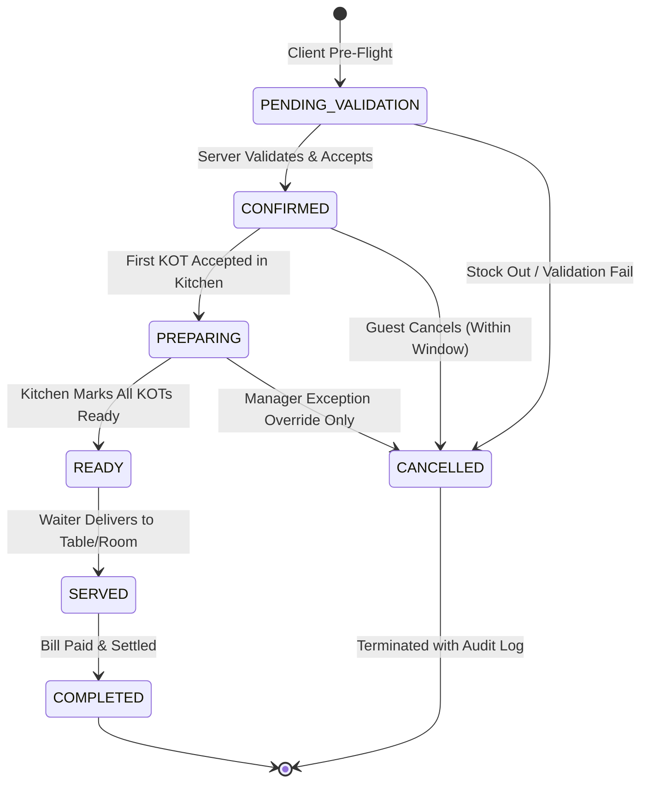
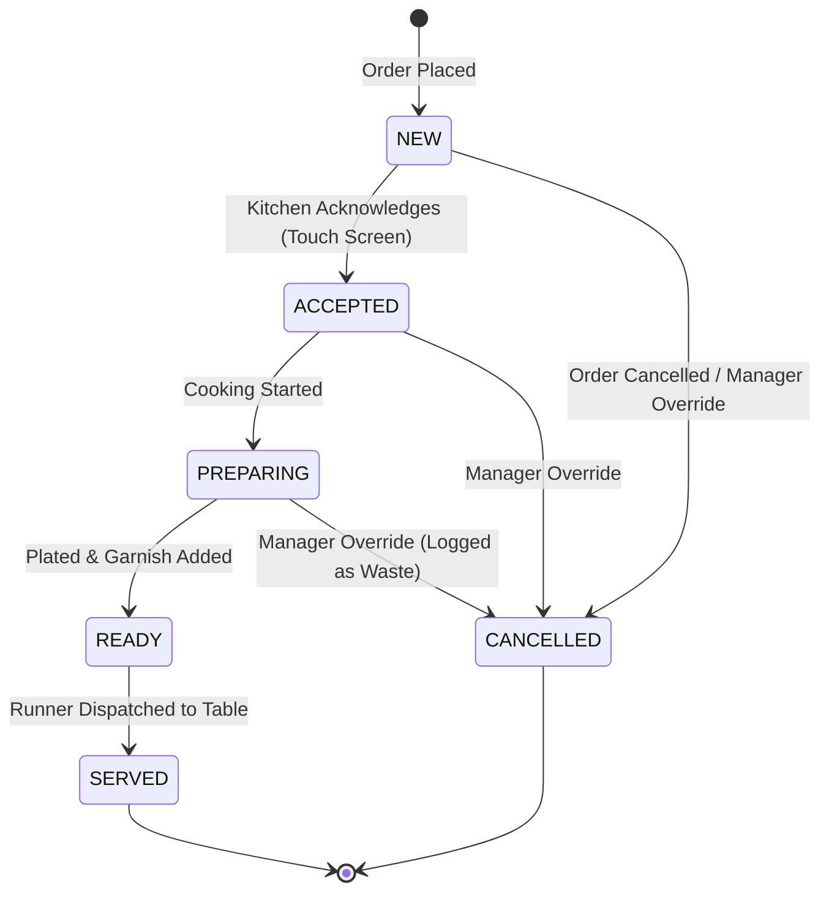

# SCULPX E-Billing — Order, KOT & Kitchen Workflow Specifications

> **Target Audience**: Backend Engineers, Kitchen Automation Specialists, Floor Supervisors  
> **Topic**: State Machines, Transition Rules, Real-Time Dispatches, Cancellation Propagation  

---

## 1. Order Lifecycle State Machine

The order lifecycle follows strict operational transitions:



### 1.1 Transition Authority Matrix

| Transition | From State | To State | Permitted Roles | Automatic or Manual? | Preconditions / Validations |
|---|---|---|---|---|---|
| **Validate & Place** | `PENDING_VALIDATION` | `CONFIRMED` | Guest (Public) / Waiter POS | Automatic on `POST /orders` | Stock available, prices verified, table/room active. |
| **Kitchen Acceptance** | `CONFIRMED` | `PREPARING` | `KITCHEN_STAFF`, `MANAGER` | Automatic when first KOT transitions to `PREPARING` | Kitchen station accepts ticket. |
| **Order Ready** | `PREPARING` | `READY` | `KITCHEN_STAFF`, `MANAGER` | Automatic when all active KOT items marked ready | Expediters verify plate readiness. |
| **Order Delivery** | `READY` | `SERVED` | `WAITER`, `CAPTAIN`, `MANAGER` | Manual via Waiter Station | Food handed to guest. Table status updated. |
| **Bill Settlement** | `SERVED` | `COMPLETED` | `CASHIER`, `MANAGER` | Automatic on `bill.status == 'PAID'` | Full payment received. Bill balance = 0. |
| **Customer Cancellation** | `CONFIRMED` | `CANCELLED` | Guest (Customer QR) | Manual via Customer UI | Permitted ONLY within 2 minutes of placement and before KOT is `PREPARING`. |
| **Staff Void / Override** | Any non-completed | `CANCELLED` | `MANAGER`, `ADMIN`, `SUPER_ADMIN` | Manual via Exception Screen | Mandatory reason logged in audit trail. |

---

## 2. KOT (Kitchen Order Ticket) Lifecycle

A customer order produces one or more KOTs. KOT status progresses independently:



### 2.1 Multi-KOT Scenarios
- **Initial Round**: KOT #1 containing Starters + Drinks.
- **Subsequent Rounds**: When guest or waiter adds Mains 20 minutes later, KOT #2 is generated linked to the SAME parent `order_id`.
- **Parent Order Aggregation**:
  - Parent Order is `PREPARING` if ANY linked KOT is `PREPARING`.
  - Parent Order is `READY` ONLY when ALL linked active KOTs are `READY`.

---

## 3. Comprehensive Cancellation Propagation

Cancellation is NEVER a silent deletion (`DELETE /orders/:id`). It is an immutable state change with widespread operational consequences across the entire system.

```mermaid
sequenceDiagram
    autonumber
    actor Actor as Customer / Manager
    participant API as Backend REST API
    participant DB as PostgreSQL Database
    participant WS as WebSocket Bus
    participant Printer as Thermal Print Agent

    Actor->>API: POST /orders/:id/cancel { reason }
    API->>DB: Check current order & KOT state
    Note over DB: Verify cooking status & cancellation window

    alt Allowed Cancellation
        API->>DB: UPDATE orders SET status = 'CANCELLED'
        API->>DB: UPDATE kots SET status = 'CANCELLED'
        API->>DB: Adjust / Restore Inventory Stock
        API->>DB: UPDATE bills SET status = 'VOIDED' (if draft)
        API->>WS: Broadcast ORDER_CANCELLED & KOT_CANCELLED
        API->>Printer: Queue Void Ticket Print (Kitchen Alert)
        API-->>Actor: 200 OK { success: true, order: ... }
    else Cancellation Rejected
        API-->>Actor: 409 Conflict { code: "ORDER_ALREADY_PREPARING" }
    end
```

### 3.1 Impact on System Components

| Component | Cancellation Effect | Policy & Rules |
|---|---|---|
| **Customer Order Tracking** | UI transitions to red CANCELLED badge with explanation banner | Polling stops; real-time event updates state immediately. |
| **Waiter Workspace** | Active order card moves to "Cancelled / Void" tab; table freed if zero other orders | Waiter alerted via toast message. |
| **Kitchen KDS** | KOT Card flashes red "CANCELLED" banner with audio buzzer, then auto-archives | Chefs immediately stop cooking pan. |
| **Kitchen Thermal Printer** | Dispatches a "VOID / CANCEL TICKET" banner printed in bold ESC/POS font | Physical proof for kitchen expediter. |
| **Billing Ledger** | Associated draft Bill is marked `VOIDED`. If bill was already issued, manager approval required | Financial audit log created. |
| **Payments & Refunds** | If payment was already taken, refund is NOT simulated by marking unpaid. An explicit `Refund` entity is created | Full payment reference & processor refund ID logged. |
| **Inventory Stock** | If raw ingredients were reserved: Reservation released. If food was already cooked: Logged as `WASTAGE` | Inventory never silently restored if food was physically cooked. |
| **Audit Log** | High-priority audit trail entry with actor, timestamp, IP, order ID, and reason | Immutable log entry in `audit_logs`. |
