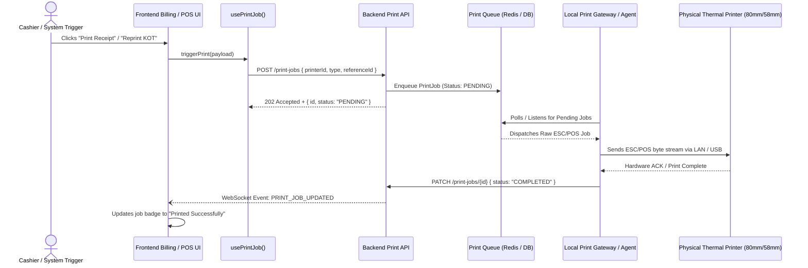

# Thermal Printer Integration Architecture

## 1. Flow of Printing in Restaurant Operations

> **Frontend Boundary Rule**:
> The frontend NEVER communicates directly with physical thermal printers via raw TCP, Web Bluetooth, or USB sockets.
> All print jobs are queued through the backend API.

---

## 2. Printer Fleet & Job Management
The admin and cashier UI provides:
1. **Fleet Health**: Shows whether kitchen, bar, and billing station printers are `ONLINE`, `OFFLINE`, or `LOW_PAPER`.
2. **Retry Mechanism**: If a printer jams or loses network connectivity, the job status moves to `FAILED`. Staff can click "Retry" directly from the UI.
3. **Reprint Audit Log**: Duplicate printings record the staff member who initiated the reprint and increment `retryCount` to prevent guest invoice duplication fraud.
