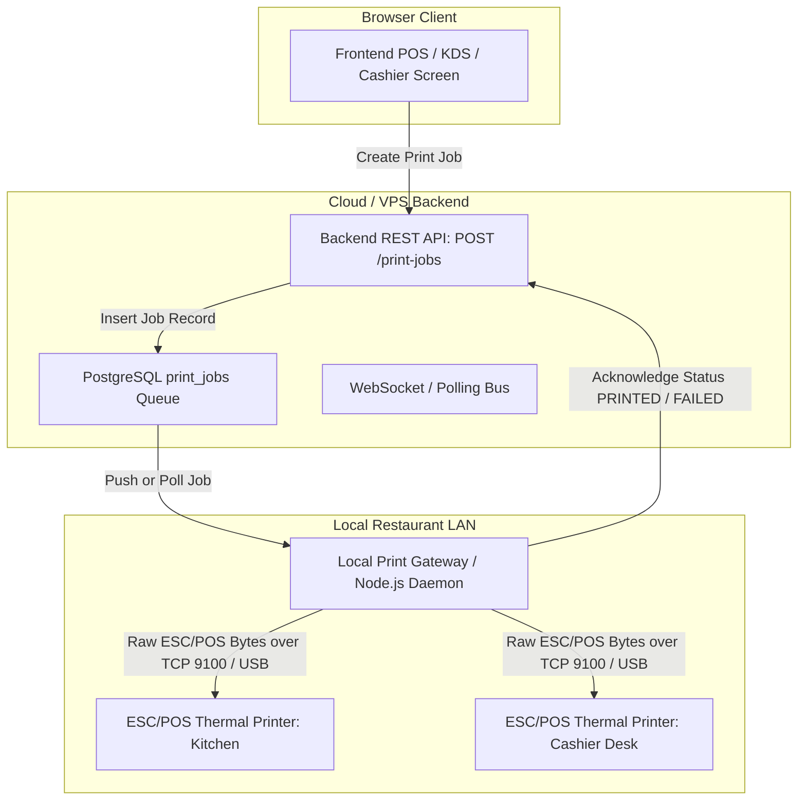
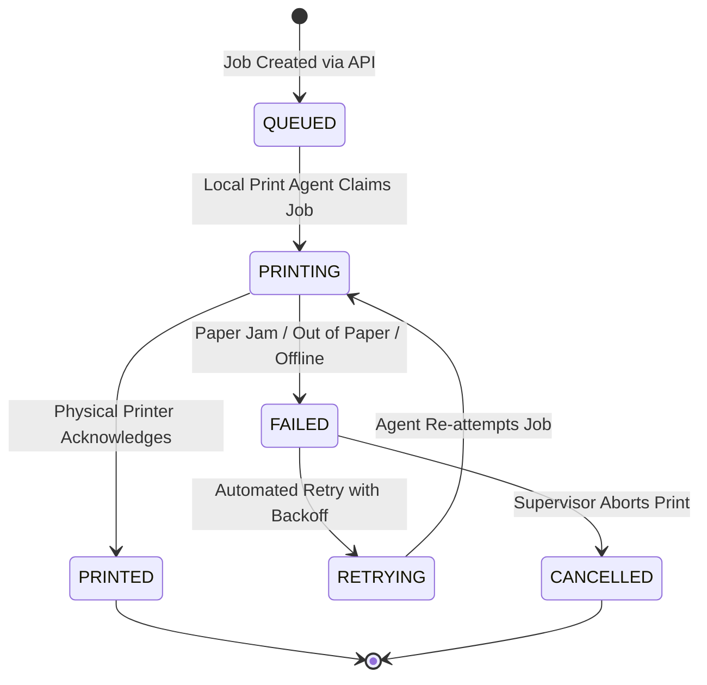

# SCULPX E-Billing — Hardware Printer Integration Specification

> **Audience**: Hardware Engineers, Local Gateway Developers, System Integration Leads  
> **Topic**: ESC/POS Thermal Printing, Print Queue State Machine, Retry Policies, Hardware Gateway  

---

## 1. Physical Printing Architecture

Browser-native `window.print()` is **NOT** acceptable as the primary architecture for automated restaurant operations. Kitchen tickets and cashier thermal receipts must trigger automatically via ESC/POS network agents:

---

## 2. Printer Types & Station Roles

1. **Kitchen KOT Thermal Printer**:
   - **Station**: Hot Kitchen / Pantry / Bar stations.
   - **Width**: Standard 80mm (3-inch) thermal paper.
   - **Format**: High-contrast, large-font items, item counts, modifier summaries, special instructions, KOT number, elapsed time, and table/room label.
   - **Auto-Cutter**: Full cut or partial cut enabled after each ticket.
   - **Audible Chime / Buzzer**: Buzzer triggered on ticket print to notify chefs.

2. **Reception / Cashier Receipt Printer**:
   - **Station**: Billing desk / cashier counter.
   - **Width**: Standard 80mm thermal paper.
   - **Format**: Property header, GSTIN, legal business address, invoice number, itemized rates, CGST, SGST, service charges, payment method breakdown, QR payment feedback, and footer greeting.

---

## 3. Print Job Lifecycle & State Machine

### 3.1 State Definitions

| State Code | Description | UI Display | Next Steps |
|---|---|---|---|
| `QUEUED` | Job registered in database; awaiting local agent pickup | Yellow badge ("Queued") | Gateway agent polls or receives socket event. |
| `PRINTING` | Agent has claimed job and is transmitting ESC/POS bytes | Blue badge ("Printing") | Awaiting printer buffer confirmation. |
| `PRINTED` | Printer completed print without error | Green badge ("Completed") | Job archived. |
| `FAILED` | TCP timeout, socket error, paper out, or cutter jam | Red badge ("Failed") | Alert displayed on Admin Printer monitor. |
| `RETRYING` | Scheduled automatic retry attempt | Orange badge ("Retrying") | Re-sent with retry count incremented. |
| `OFFLINE` | Printer IP ping / status check failed | Gray badge ("Offline") | Hardware diagnostics needed. |
| `CANCELLED`| Supervisor manually cancelled unprinted job | Red/Gray badge ("Cancelled") | Reason recorded in audit log. |

---

## 4. Duplicate Prevention & Reprint Safeguards

1. **Idempotent Dispatch**:
   - Each print job generates a unique `print_job_id`.
   - Repeated dispatches of the same order/bill check whether an active job already exists in `QUEUED` or `PRINTING` states.
2. **Reprint Watermark**:
   - When a cashier or manager clicks "Reprint Bill" or "Reprint KOT", the backend creates a NEW job with `is_reprint = true`.
   - The generated ESC/POS template MUST print a large, bold `*** DUPLICATE / REPRINT COPY ***` header to prevent duplicate food preparation or financial fraud.

---

## 5. Distinction Between Screen Preview and Physical Print

The frontend interface maintains strict semantic clarity:
- **Print Preview**: Renders an on-screen visual modal of the thermal ticket for staff review.
- **Print Job Queued**: Confirms that the print instruction was accepted by the server.
- **Physical Print Confirmed**: Confirms that the physical hardware printer acknowledged completion to the local print agent.
