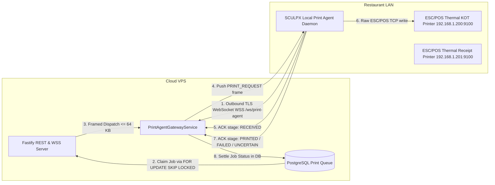

# SCULPX E-Billing — Secure Local Print Agent Operations Manual

> **Audience**: Venue IT Specialists, Restaurant System Administrators, Deployment Engineers  
> **Component**: Outbound Local Print Agent (`agent/`), Cloud WebSocket Gateway (`backend`)  
> **Status**: Verified in Automated Test Environment (Phase 6F)

---

## 1. Architecture Overview

In a typical hospitality deployment, thermal receipt and KOT printers operate on an isolated Local Area Network (LAN) (e.g. `192.168.1.0/24`) behind a NAT router or firewall. The cloud Fastify backend runs on a remote VPS or PaaS.

Raw ESC/POS printing over TCP port 9100 **must never be exposed over the public Internet**.

The **SCULPX Local Print Agent** resolves this by initiating an **outbound-only TLS WebSocket connection** from the restaurant LAN to the cloud gateway:



### Key Security & Operational Guarantees
1. **Zero Inbound Router Ports**: No port forwarding, UPnP, or dynamic DNS needed at the venue.
2. **Dedicated Device Authentication**: Print agents authenticate with a unique `deviceId` and long-random secret (`sculpx_ag_...`), never reusing staff JWTs.
3. **SSRF & Network Boundary Protection**: The local agent validates all target printer hosts against a private RFC 1918 subnet allowlist and rejects loopback (`127.0.0.1`), cloud metadata (`169.254.169.254`), and unauthorized ports.
4. **Framed Limits**: Strict 64 KB ceiling on print job payloads and 8 KB for control/ACK messages.
5. **No Blind Retries**: Ambiguous delivery (cable disconnection or socket timeout mid-write) flags `UNCERTAIN` to prevent duplicate tickets and food wastage.

---

## 2. Agent Enrollment & Device Registration

Before starting an agent on site, register the device via the admin REST API:

### Step 1: Register Device in Cloud
Authorized roles: `ADMIN`, `SUPER_ADMIN`.

```bash
POST /api/v1/print-agents
Authorization: Bearer <STAFF_ADMIN_JWT>
Content-Type: application/json

{
  "name": "Main Cashier Counter Agent",
  "deviceId": "venue-pos-cashier-01",
  "permittedPrinterIds": [
    "d77576ab-58ad-41f3-a929-d3ea3b163028",
    "8000afda-fd3b-4b13-8f42-abe5aea61ede"
  ],
  "metadata": {
    "venue": "Downtown Bistro",
    "terminal": "Counter POS PC",
    "os": "Windows 11 Pro"
  }
}
```

**Response (HTTP 201)**:
```json
{
  "success": true,
  "data": {
    "agent": {
      "id": "e4f5a6b7-0000-4000-8000-000000000001",
      "tenantId": "e1b1d1f0-0000-4000-8000-000000000001",
      "name": "Main Cashier Counter Agent",
      "deviceId": "venue-pos-cashier-01",
      "status": "ACTIVE",
      "isOnline": false,
      "permittedPrinterIds": [
        "d77576ab-58ad-41f3-a929-d3ea3b163028",
        "8000afda-fd3b-4b13-8f42-abe5aea61ede"
      ]
    },
    "apiKey": "sculpx_ag_a9f1b2c3d4e5f60718293a4b5c6d7e8f90123456789abcde"
  },
  "message": "Print agent registered successfully. Store API key safely; it cannot be retrieved again."
}
```

> [!IMPORTANT]
> The plain `apiKey` is returned **only once**. The cloud database stores only its salted SHA-256 hash.

---

## 3. Venue Cashier PC / Dedicated Device Installation

### Hardware & Software Requirements
- **OS**: Linux (Debian/Ubuntu/Raspberry Pi OS), Windows 10/11, or macOS.
- **Runtime**: Node.js v20+ LTS or v22 LTS with `npm`.
- **Network**: Outbound HTTPS/WSS access to cloud backend host (port 443). Local Ethernet/Wi-Fi connection to LAN thermal printers (port 9100).

### Directory Setup
Copy or clone the `agent/` folder to the target venue machine (e.g. `C:\sculpx\agent` or `/opt/sculpx-agent`):

```bash
cd /opt/sculpx-agent
npm install --omit=dev
```

### Environment Configuration (`.env`)
Create `/opt/sculpx-agent/.env` (permissions `chmod 600`):

```env
# Cloud WebSocket Gateway endpoint
PRINT_AGENT_CLOUD_URL=wss://api.yourrestaurant.com/ws/print-agent

# Registered Device Identity & Secret
PRINT_AGENT_DEVICE_ID=venue-pos-cashier-01
PRINT_AGENT_API_KEY=sculpx_ag_a9f1b2c3d4e5f60718293a4b5c6d7e8f90123456789abcde

# Printer Security Policy (LAN allowlists)
ALLOWED_PRINTER_PORTS=9100,9101,9102
ALLOWED_PRINTER_HOSTS=192.168.1.200,192.168.1.201,192.168.1.202
ALLOW_PRIVATE_SUBNETS_ONLY=true

# Socket Timeouts (milliseconds)
PRINTER_CONNECT_TIMEOUT_MS=3000
PRINTER_WRITE_TIMEOUT_MS=5000
AGENT_HEARTBEAT_INTERVAL_MS=15000

# Logging level (debug | info | warn | error)
AGENT_LOG_LEVEL=info
```

### Running as a Background Daemon

#### Option A: Linux systemd Service
Create `/etc/systemd/system/sculpx-print-agent.service`:

```ini
[Unit]
Description=SCULPX Secure Local Print Agent Daemon
After=network.target

[Service]
Type=simple
User=sculpx
WorkingDirectory=/opt/sculpx-agent
EnvironmentFile=/opt/sculpx-agent/.env
ExecStart=/usr/bin/node dist/index.js
Restart=always
RestartSec=5
StandardOutput=journal
StandardError=journal

[Install]
WantedBy=multi-user.target
```

Enable and start:
```bash
sudo systemctl daemon-reload
sudo systemctl enable sculpx-print-agent
sudo systemctl start sculpx-print-agent
sudo systemctl status sculpx-print-agent
```

#### Option B: PM2 Process Manager
```bash
pm2 start dist/index.js --name "sculpx-print-agent" --env .env
pm2 save
pm2 startup
```

---

## 4. Secret Rotation & Device Revocation

### Rotating Device Secret
If a credential was exposed or rotated per periodic security policy:

```bash
POST /api/v1/print-agents/{agentId}/rotate-key
Authorization: Bearer <STAFF_ADMIN_JWT>
```

**Outcome**:
1. Server immediately closes existing active WebSocket with code `4001 API_KEY_ROTATED`.
2. Database hash is updated.
3. Update `PRINT_AGENT_API_KEY` in the venue `.env` and restart service (`systemctl restart sculpx-print-agent`).

### Revoking a Compromised or Retired Device
```bash
POST /api/v1/print-agents/{agentId}/revoke
Authorization: Bearer <STAFF_ADMIN_JWT>
```

**Outcome**:
1. Server immediately terminates active connection with close code `4003 AGENT_REVOKED`.
2. All assigned printers are flagged `isOnline: false`.
3. Agent cannot reconnect without manual admin reactivation.

---

## 5. Monitoring & Operational Status

Staff and managers can monitor fleet health in real time:

- **REST Fleet Endpoint**: `GET /api/v1/print-agents`
  Returns online/offline status, IP seen by cloud, last heartbeat, and connected printer IDs.
- **WebSocket Fleet Events**:
  Subscribing to topic `printers:agents` emits real-time events:
  ```json
  {
    "eventType": "PRINT_AGENT_STATUS",
    "topic": "printers:agents",
    "payload": {
      "agentId": "e4f5a6b7-...",
      "deviceId": "venue-pos-cashier-01",
      "name": "Main Cashier Counter Agent",
      "status": "CONNECTED",
      "timestamp": "2026-10-11T20:30:00.000Z"
    }
  }
  ```

---

## 6. Recovery & Ambiguous Delivery Troubleshooting

| Symptom | Root Cause | Resolution |
|---|---|---|
| Agent logs `[AUTH_FAILED]` | Invalid API key or device ID | Check `PRINT_AGENT_API_KEY` against registration output or rotate key. |
| Job marked `UNCERTAIN` | Socket disconnected or timed out mid-write | Check printer paper and physical power. Review visual print before calling `/print-jobs/:id/retry` or `/print-jobs/:id/cancel`. |
| Agent logs `SECURITY_VIOLATION` | Cloud requested IP outside allowed hosts or port | Verify printer IP is in `ALLOWED_PRINTER_HOSTS` and within private RFC 1918 range. |
| Agent logs `FRAME_TOO_LARGE` | Print document snapshot exceeded 64 KB | Reduce image resolution or excessive receipt item snapshots. |
| Agent frequently reconnects | Venue Wi-Fi instability | Switch Cashier PC to wired Ethernet connection. |
