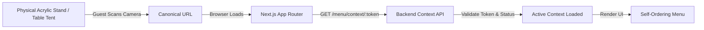

# SCULPX E-Billing — QR Code System Specification

> **Component**: `src/features/admin/QRCodeGeneratorManager.tsx` (`/admin/qr`)  
> **Route Resolvers**: `/menu/table/[tableId]`, `/menu/room/[roomId]`, `/menu/[qrToken]`  
> **Canonical Base URL**: `ENV.APP_URL` (configured via `NEXT_PUBLIC_APP_URL`)  

---

## 1. System Overview

The QR system connects the physical hospitality environment (table tents, room key cards, acrylic stands) to digital self-ordering:



---

## 2. Canonical URL Schema

QR codes must NEVER contain hardcoded development hostnames (`localhost:3000`). All generated QR URLs build from `ENV.APP_URL` configured in the deployment environment:

### 2.1 Table QR URL Structure
```text
${NEXT_PUBLIC_APP_URL}/menu/table/${tableIdentifier}
```
Example:
`https://pos.grandroyalpalace.com/menu/table/T01`

### 2.2 Room In-Room Dining URL Structure
```text
${NEXT_PUBLIC_APP_URL}/menu/room/${roomNumber}
```
Example:
`https://pos.grandroyalpalace.com/menu/room/301`

### 2.3 Cryptographic Token URL Structure (Proposed Production Mode)
```text
${NEXT_PUBLIC_APP_URL}/menu/${opaqueToken}
```
Example:
`https://pos.grandroyalpalace.com/menu/qr_8f7b2c0199e4`

---

## 3. QR Identifier vs. Authorization Token

| Characteristic | Human Identifier (`T01`, `301`) | Opaque Token (`qr_8f7b2c01...`) |
|---|---|---|
| **Readability** | Readable on physical printed stands. | Unguessable random hash. |
| **Security** | Susceptible to sequential browsing if unmitigated. | Resilient against guessing or tampering. |
| **Revocation** | Difficult to revoke without re-labeling tables. | Instantly revocable in database without re-printing if dynamic routing is used. |
| **Recommendation** | Ideal for physical print labels. | Backend maps physical label to rotating active session token. |

---

## 4. Activation, Expiration & Deactivation Safeguards

1. **Active State Verification**:
   - Every time `/menu/context/:token` is queried, backend checks `qr_codes.is_active` and `tables.status`.
   - If the station is marked `INACTIVE` or table is undergoing maintenance, API returns `410 Gone`.
   - Frontend renders the dedicated `QR_DEACTIVATED` screen explaining that the table is closed for seating.
2. **Session Timeout & Turnover**:
   - Once a table bill is marked `PAID` and table transitions to `VACANT`, the previous customer's cart and order associations are severed.
   - Subsequent scans by new arriving diners initiate a fresh order session.

---

## 5. Physical Print Layouts & Export Features

Implemented in `QRCodeGeneratorManager.tsx`:
- **High-Resolution PNG Export**: 1024x1024 px PNG rendering using `qrcode` library with maximum contrast (pure `#000000` modules on `#FFFFFF` quiet zone).
- **Direct Thermal Print**: Sends formatted ESC/POS raster print to designated counter printer for instant tabletop badge sticker generation.
- **Bulk Table Sheet Print**: Standardized A4 grid layout allowing administrative printing of 12 table QR badges per sheet with cut lines and table labels.
