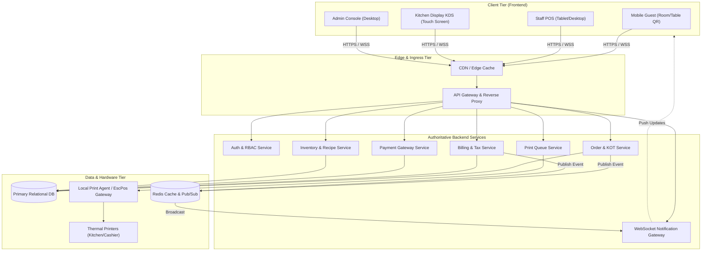

# System Architecture

## 1. High-Level System Overview
The platform uses a decoupled frontend-backend architecture. The Next.js frontend interacts with the authoritative backend services through REST APIs for idempotent queries and mutations, and through WebSockets for full-duplex, low-latency live events.

---

## 2. Communication Protocols

| Channel | Protocol | Use Case | Guarantees |
| :--- | :--- | :--- | :--- |
| **Data Fetching & Mutations** | HTTPS / REST (JSON) | Initial loads, checkout validation, payments, admin CRUD | Idempotent, typed contract envelopes, auth tokens |
| **Live Broadcasts** | WSS (Secure WebSocket) | Order state changes, new KOT tickets, bill updates | Event deduplication, automatic reconnect with exponential backoff |
| **Printing** | Backend-mediated Queue | KOT and receipt generation | Frontend NEVER speaks directly to raw thermal sockets |

---

## 3. Resilience & Degradation Strategy
1. **WebSocket Degradation**: If WebSocket connection fails, TanStack Query automatically falls back to interval polling (window focus revalidation & stale-while-revalidate).
2. **Offline Detection**: PWA shell detects navigator connectivity changes and informs the user immediately to prevent lost cart or payment submissions.
3. **Optimistic Updates with Server Authority**: Client displays immediate feedback for actions like quantity increments, but final order placement waits for server confirmation.
