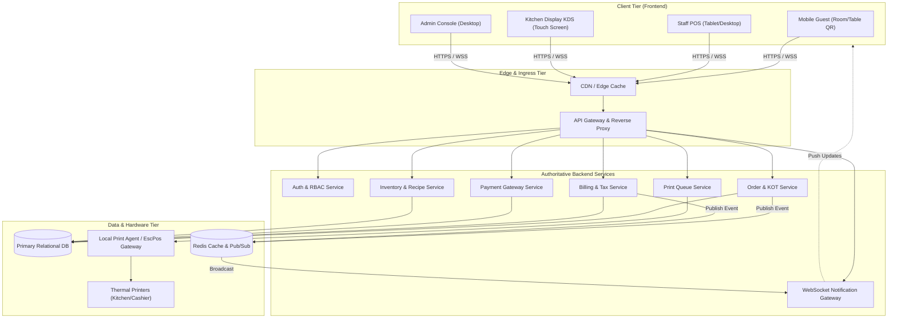
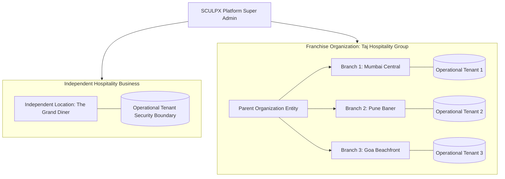

# System Architecture

## 1. High-Level System Overview
The platform uses a decoupled frontend-backend architecture. The Next.js frontend interacts with the authoritative backend services through REST APIs for idempotent queries and mutations, and through WebSockets for full-duplex, low-latency live events.

---

## 2. Communication Protocols

| Channel | Protocol | Use Case | Guarantees |
| :--- | :--- | :--- | :--- |
| **Data Fetching & Mutations** | HTTPS / REST (JSON) | Initial loads, checkout validation, payments, admin CRUD | Idempotent, typed contract envelopes, auth tokens |
| **Live Broadcasts** | WSS (Secure WebSocket) | Order state changes, new KOT tickets, bill updates | Event deduplication, automatic reconnect with exponential backoff |
| **Printing** | Backend-mediated Queue | KOT and receipt generation | Frontend NEVER speaks directly to raw thermal sockets |

---

## 3. Resilience & Degradation Strategy
1. **WebSocket Degradation**: If WebSocket connection fails, TanStack Query automatically falls back to interval polling (window focus revalidation & stale-while-revalidate).
2. **Offline Detection**: PWA shell detects navigator connectivity changes and informs the user immediately to prevent lost cart or payment submissions.
3. **Optimistic Updates with Server Authority**: Client displays immediate feedback for actions like quantity increments, but final order placement waits for server confirmation.

---

## 4. Multi-Tenant, Franchise & Multi-Location Hierarchy

SCULPX E-Billing operates as a multi-tenant hospitality platform supporting independent restaurants, independent hotels, combined hospitality properties, and multi-unit franchise organizations.

### Separation of Concerns & Boundary Definitions
1. **Organization (`Organization` model)**: Parent business entity or franchise brand. Contains corporate details, legal name, tax identifiers, and franchise-level brand settings. Independent businesses have no parent organization (`organizationId: null`).
2. **Location (`Location` model)**: Physical branch or property (restaurant, hotel, or combined). Contains address, city, timezone, currency, GSTIN, and enabled hospitality modules.
3. **Operational Tenant (`Tenant` model)**: Hard security isolation boundary in PostgreSQL. Each Location links 1-to-1 with an operational Tenant (`tenantId @unique`). All operational records (`tables`, `rooms`, `menu_categories`, `menu_items`, `orders`, `bills`, `payments`, `inventory`, `printers`) are strictly scoped to `tenantId`.
4. **Lifecycle & Suspension Rules**:
   - `ACTIVE`: Full operational capabilities.
   - `SUSPENDED`: Read-only historical data access. Any state-modifying requests (`POST`, `PUT`, `PATCH`, `DELETE`) on operational tables, rooms, orders, or bills are rejected with HTTP 403 `LOCATION_SUSPENDED`. Historical invoices, ledger entries, and audit logs remain immutable.
   - `ARCHIVED`: Property decommissioned, preserved for accounting and regulatory retention.
