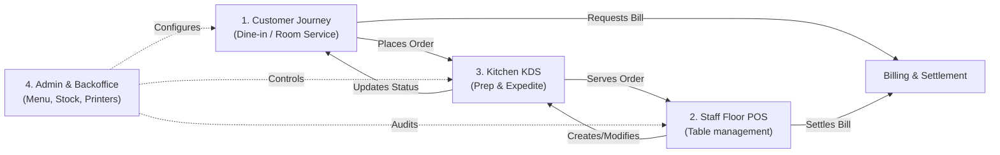

# User Flows Overview

The system orchestrates four key operational loops in a hospitality ecosystem:

---

## Personas & Primary Entry Points

| Persona | Flow Document | Primary Route | Supported Devices |
| :--- | :--- | :--- | :--- |
| **Diner / Guest** | [CUSTOMER_FLOW.md](./CUSTOMER_FLOW.md) | `/menu/[qrToken]` | Mobile Smartphones (iOS/Android PWA) |
| **Waiter / Captain** | [STAFF_FLOW.md](./STAFF_FLOW.md) | `/pos`, `/tables` | Tablets & Handheld POS |
| **Kitchen Chef / Expeditor** | [KITCHEN_FLOW.md](./KITCHEN_FLOW.md) | `/kitchen` | Large Touch Displays / Mounted Tablets |
| **Cashier / Accounts** | [STAFF_FLOW.md](./STAFF_FLOW.md) | `/billing` | Counter Desktops / Thermal POS Terminals |
| **Restaurant Manager / Admin** | [ADMIN_FLOW.md](./ADMIN_FLOW.md) | `/admin` | Desktop / Laptop Workstations |
