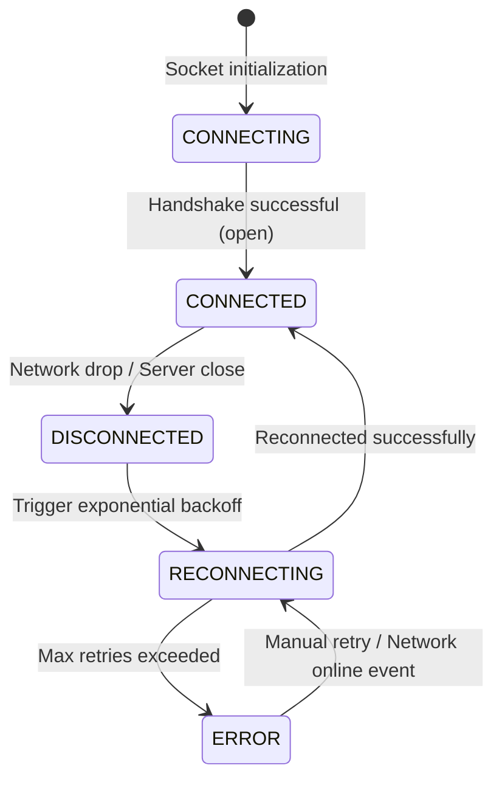

# WebSocket Contract & Real-Time Event Architecture

## 1. Single Shared WebSocket Architecture
To prevent connection thrashing, resource leakage, and battery drain on mobile devices:
> **Never open multiple WebSocket connections per page or component.**
> All real-time telemetry flows through a single centralized `WebSocketManager`.

```mermaid
graph TD
    WSGateway[WebSocket Server Gateway: /ws] <-->|WSS Duplex Stream| ConnMgr[Connection Manager]

    subgraph Client Architecture
        ConnMgr -->|Heartbeat / Ping-Pong| Health[Heartbeat & Backoff Monitor]
        ConnMgr -->|Raw Frame| Dedupe[Deduplication Buffer (Message ID)]
        Dedupe --> Dispatcher[Event Dispatcher]

        Dispatcher -->|ORDER_* events| OrderHooks[useOrderUpdates Hook]
        Dispatcher -->|KOT_* events| KitchenHooks[useKitchenUpdates Hook]
        Dispatcher -->|BILL_* events| BillingHooks[useBillingUpdates Hook]
        Dispatcher -->|PRINT_* events| PrintHooks[usePrintJobUpdates Hook]

        OrderHooks --> QueryCache[TanStack Query Cache Invalidation]
        KitchenHooks --> QueryCache
        BillingHooks --> QueryCache
        PrintHooks --> QueryCache

        QueryCache --> UI[Reactive UI Views]
    end
```

---

## 2. Event Envelope Standard

All frames received from the server follow the envelope schema:
```typescript
interface WebSocketMessage<T = unknown> {
  type: WebSocketEventType;
  topic?: string;      // e.g., "orders:all", "order:ord-101", "kitchen:all"
  payload: T;
  timestamp: string;   // ISO 8601 string
  id: string;          // UUID for client-side deduplication
}
```

---

## 3. Supported Real-Time Events Catalog

| Event Type | Typical Topic | Trigger Scenario | Payload Type |
| :--- | :--- | :--- | :--- |
| `ORDER_CREATED` | `orders:all` | New order submitted by diner or POS | `OrderEventPayload` |
| `ORDER_CONFIRMED` | `order:{id}` | Order accepted by kitchen/manager | `OrderEventPayload` |
| `ORDER_UPDATED` | `order:{id}` | Item added or notes modified | `OrderEventPayload` |
| `ORDER_CANCELLED` | `order:{id}` | Order cancelled by guest/staff | `OrderEventPayload` |
| `KOT_CREATED` | `kitchen:all` | New kitchen ticket routed to stations | `KOTEventPayload` |
| `KOT_UPDATED` | `kitchen:all` | Status moves (`ACCEPTED`, `PREPARING`, `READY`) | `KOTEventPayload` |
| `ORDER_PREPARING`| `order:{id}` | Kitchen begins preparation | `OrderEventPayload` |
| `ORDER_READY` | `order:{id}` | Food plated, audio notification chime | `OrderEventPayload` |
| `ORDER_SERVED` | `order:{id}` | Food delivered to guest table/room | `OrderEventPayload` |
| `BILL_UPDATED` | `billing:all` | Bill generated or discount applied | `BillEventPayload` |
| `PAYMENT_UPDATED`| `billing:all` | Payment received and verified | `PaymentEventPayload` |
| `PRINT_JOB_UPDATED`| `printers:all`| Print job completes or fails | `PrintJobEventPayload` |

---

## 4. Connection Lifecycle & Reconnection State Machine



### Exponential Backoff Policy
- Initial delay: 1,000ms
- Backoff multiplier: 1.5x
- Jitter: ±20% randomized jitter to prevent thundering herds
- Maximum delay cap: 30,000ms
- Automatic reset on successful connection after 5 seconds of stability.
