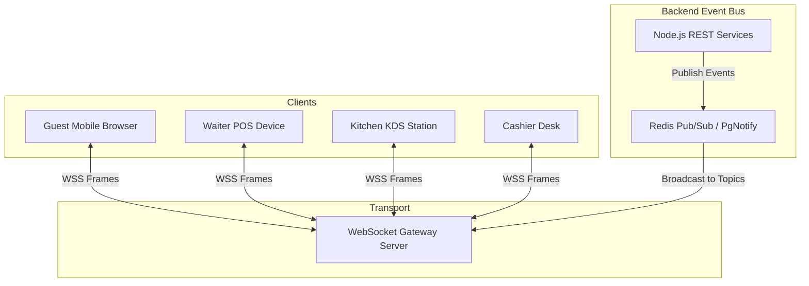

# SCULPX E-Billing — Real-Time WebSocket Contract Specification

> **Endpoint**: `NEXT_PUBLIC_WS_URL` (e.g. `ws://localhost:8000/ws` or `wss://api.yourdomain.com/ws`)  
> **Client Implementation**: `src/services/websocket/socket.service.ts` (`WebSocketManager`)  
> **Protocol**: Bidirectional JSON over WebSocket with heartbeat and message deduplication  

---

## 1. Architectural Architecture



### 1.1 Source of Truth Principle
- **REST APIs remain the primary source of truth** for reading and writing entity states.
- **WebSocket events act as real-time invalidation & progression signals**.
- Upon receiving a WebSocket event, frontend TanStack Query hooks invalidate cached queries or merge state patches.
- If the WebSocket connection drops, the frontend transparently falls back to periodic background polling until reconnected.

---

## 2. Connection Lifecycle & Wire Protocol

### 2.1 Connection Handshake & Authentication
1. **Connection URL**:
   - Internal staff: `wss://api.yourdomain.com/ws?token=<jwt_access_token>`
   - Public guest: `wss://api.yourdomain.com/ws?orderId=<order_id>&tableId=<table_id>`
2. **Heartbeat Protocol**:
   - Client sends heartbeat frame every 25 seconds:
     ```json
     { "type": "HEARTBEAT", "timestamp": 1728562800000 }
     ```
   - Server responds with `{ "type": "HEARTBEAT_ACK", "timestamp": 1728562800050 }`.
3. **Reconnection Strategy**:
   - Implemented in `socket.service.ts`:
   - Exponential backoff: `delay = min(1000 * 1.5^attempt, 30000) + random_jitter`.
   - Max reconnection attempts: 10 before signaling an error banner.

### 2.2 Wire Frame Schema
Every inbound and outbound message follows the standard frame:

```typescript
interface WebSocketMessage<T = unknown> {
  id: string;          // Unique UUID for client deduplication
  type: string;        // Event Type enum (e.g. "ORDER_CREATED")
  topic?: string;      // Channel or scope (e.g. "restaurant:orders", "order:ord-101")
  payload: T;          // Typed data payload
  timestamp: string;   // ISO 8601 UTC timestamp
}
```

---

## 3. Topic Subscription Model

Clients subscribe to specific operational topics based on their station:

| Client Station | Subscribed Topics | Purpose |
|---|---|---|
| **Guest Customer** | `order:<orderId>` | Tracks progress of personal order. |
| **Waiter POS** | `restaurant:tables`, `restaurant:orders` | Table turn status and order progress. |
| **Kitchen KDS** | `kitchen:kots`, `kitchen:alerts` | New tickets, status updates, cancellations. |
| **Cashier Desk** | `restaurant:billing`, `restaurant:payments`| Bill requests, settled payments. |
| **Hardware Fleet** | `printers:jobs` | Print job failures and retry updates. |

### Client Subscription Frames:
```json
// Subscribe to Topic
{ "type": "SUBSCRIBE", "topic": "kitchen:kots" }

// Unsubscribe from Topic
{ "type": "UNSUBSCRIBE", "topic": "kitchen:kots" }
```

---

## 4. Master Event Catalog

### 4.1 Order Lifecycle Events

#### `ORDER_CREATED`
- **Trigger**: New order successfully validated and accepted by server.
- **Subscribers**: Waiter POS, Manager, Kitchen KDS.
- **Payload**: Full `Order` object including customer, table, and item breakdown.

#### `ORDER_STATUS_UPDATED`
- **Trigger**: Order transitions (e.g. `CONFIRMED` -> `PREPARING` -> `READY` -> `SERVED`).
- **Subscribers**: Customer tracking screen (`/order/[orderId]`), Waiter POS, Manager.
- **Payload**:
  ```json
  {
    "orderId": "ord-101",
    "status": "READY",
    "updatedAt": "2026-10-10T15:15:00.000Z",
    "note": "All items plated"
  }
  ```

#### `ORDER_CANCELLED`
- **Trigger**: Customer or manager cancels order.
- **Subscribers**: Customer, Waiter, Kitchen KDS, Cashier.
- **Payload**: `{ "orderId": "ord-101", "reason": "Guest departed", "cancelledAt": "2026-10-10T15:10:00.000Z" }`

---

### 4.2 Kitchen KDS Events

#### `KOT_CREATED`
- **Trigger**: Kitchen order ticket generated from order submission or incremental item addition.
- **Subscribers**: Kitchen KDS (`/kitchen`), Kitchen thermal printer.
- **Payload**: Full `KOT` entity with item breakdown, modifiers, and preparation urgency.

#### `KOT_STATUS_UPDATED`
- **Trigger**: Kitchen chef taps ticket on KDS (`ACCEPTED`, `PREPARING`, `READY`, `SERVED`).
- **Subscribers**: Expediter, Waiter terminal, Manager overview.
- **Payload**: `{ "kotId": "kot-101", "orderId": "ord-101", "status": "PREPARING", "elapsedSeconds": 120 }`

---

### 4.3 Billing & Payment Events

#### `BILL_UPDATED`
- **Trigger**: Bill generated, discount applied, or split.
- **Subscribers**: Cashier desk, Customer digital bill.
- **Payload**: Full updated `Bill` entity with recalculated balance.

#### `PAYMENT_RECORDED`
- **Trigger**: UPI webhook verified or cashier records tender.
- **Subscribers**: Cashier ledger, Customer bill screen, Manager revenue tracker.
- **Payload**:
  ```json
  {
    "paymentId": "pay-9921",
    "billId": "bill-101",
    "orderId": "ord-101",
    "amount": 1364,
    "method": "UPI",
    "status": "SUCCESS"
  }
  ```

---

### 4.4 Hardware Printer Events

#### `PRINT_JOB_STATUS`
- **Trigger**: Thermal printer agent reports job queued, printing, completed, or failed.
- **Subscribers**: Admin printer monitor (`/admin/printers`, `/admin/print-jobs`).
- **Payload**:
  ```json
  {
    "jobId": "job-881",
    "printerId": "prn-kot-main",
    "status": "FAILED",
    "errorMessage": "Thermal paper roll empty"
  }
  ```

---

## 5. Deduplication & Idempotency Safeguards

Implemented in `src/services/websocket/socket.service.ts`:
- Each received frame is checked against `processedMessageIds: Set<string>`.
- Duplicate frames (e.g. caused by network re-transmission) are silently dropped.
- Dedup set is bounded to 1,000 recent message IDs with FIFO eviction to prevent memory growth.
